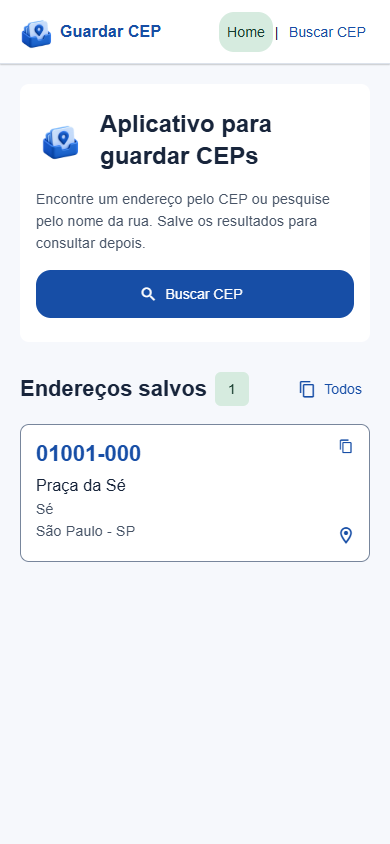

# Guardar CEP

Aplicativo para encontrar e guardar endereços brasileiros, desenvolvido com React Native, Expo e TypeScript. O mesmo projeto oferece uma interface para Android e navegador.

<p align="center">
  
</p>

## Funcionalidades

- Consulta de endereço pelo CEP usando ViaCEP.
- Busca de CEPs por UF, cidade e parte do nome do logradouro.
- Seleção de UF em uma lista com todos os estados.
- Busca pela localização do dispositivo no aplicativo nativo, com permissão solicitada ao usuário e confirmação do endereço antes de salvar.
- Histórico de endereços salvo no dispositivo com AsyncStorage.
- Home com os endereços salvos e exclusão de itens na tela de busca.
- Cópia do CEP, do endereço, de um registro completo ou de toda a lista pela Home.
- Abertura de endereços no Google Maps pela Home.
- Interface com React Native Paper, tema e tokens compartilhados.
- Ajustes de rolagem para manter os campos acessíveis durante a digitação no celular.
- Identidade visual, ícone e splash configurados para a versão instalada.

## Prévia

<p align="center">
  
</p>

## Tecnologias

React Native 0.88, React 19, Expo SDK 58, Expo Router, TypeScript, React Native Paper, AsyncStorage, Expo Location, Expo Clipboard e ViaCEP. As versões exatas estão em package.json e package-lock.json.

## Executar localmente

É necessário ter Node.js compatível com o Expo SDK 58 e npm instalados.

```bash
git clone https://github.com/igortomp100/reactive-native-cep-search.git
cd reactive-native-cep-search
npm ci
npm start
```

No Android, abra o projeto com o Expo Go. O computador e o celular precisam conseguir se comunicar pela rede. Como alternativa à conexão local:

```bash
npx expo start --go --tunnel ngrok
```

O túnel mantém o servidor de desenvolvimento acessível por um endereço temporário enquanto estiver ativo.

Para testar no navegador:

```bash
npm run web
```

## Verificações

```bash
npm run typecheck
npm run lint
npm test
npm run test:coverage
```

Jest com jest-expo e React Native Testing Library verifica as consultas ao ViaCEP e a persistência dos endereços. A rede e o AsyncStorage são simulados: os testes funcionam sem internet ou aparelho conectado e não acessam os dados salvos no celular.

Use `npm run test:watch` durante o desenvolvimento. A cobertura gerada por `npm run test:coverage` considera somente `src/services/enderecos.ts` e `src/hooks/useEnderecoStore.ts`. O relatório HTML fica em `coverage/lcov-report/index.html`. Consulte [a estratégia de testes](docs/TESTES.md) para entender os cenários e os limites desta etapa.

## Gerar um APK

É necessário ter uma conta Expo, acesso ao projeto EAS e credenciais de assinatura próprias para gerar uma build.

```bash
npx eas-cli@latest login
npx eas-cli@latest build --platform android --profile preview
```

O perfil preview usa distribuição interna. O APK pode ser instalado diretamente no Android e funciona sem o computador ou Expo Go. Gerar a build não publica o aplicativo na Google Play. Para usar outra conta Expo, configure seu próprio projeto EAS e suas credenciais antes de gerar builds.

O ícone instalado e a splash nativa exigem uma nova build após alterações. O Expo Go não reproduz completamente a splash final.

## Organização do código

```text
src/
  app/          Rotas e layout compartilhado
  components/   Cards, navegação e formulários
  contexts/     Estado compartilhado dos endereços
  hooks/        Persistência, cópia e comportamento do teclado
  services/     ViaCEP, localização, mapas e formatação
  constants/    Estados brasileiros e ajustes dos campos
  theme/        Tema, tokens e estilos compartilhados
assets/brand/   Arquivos da identidade visual
```

## Decisões e limites atuais

- Os endereços ficam no armazenamento local de cada instalação ou navegador; não existe sincronização entre dispositivos.
- As consultas ao ViaCEP precisam de internet. Endereços já salvos podem ser consultados localmente.
- A busca por localização está disponível no aplicativo nativo; não foi implementada a conversão de coordenadas em endereço no navegador.
- A localização fornece uma sugestão e pode não identificar o endereço exato. O usuário deve conferir os dados antes de salvar.
- A abertura do mapa pesquisa o endereço e CEP, sem usar coordenadas GPS armazenadas.
- O nome público é Guardar CEP. O nome deste repositório é reactive-native-cep-search.

## Identidade e licença

A identidade visual da caixinha com cartões de endereço foi criada com auxílio de geração de imagens. As variações estão documentadas em assets/brand/README.md.

O projeto inclui a licença MIT e o aviso de direitos autorais do template Expo, preservados em LICENSE.
